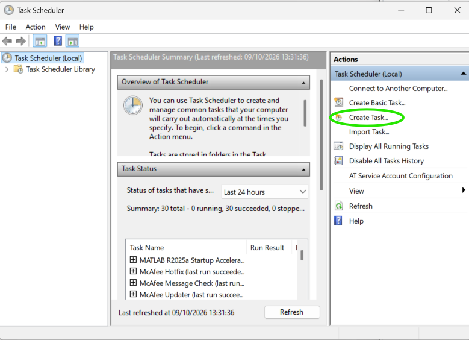
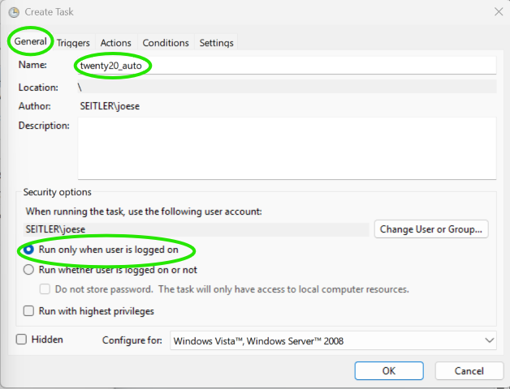
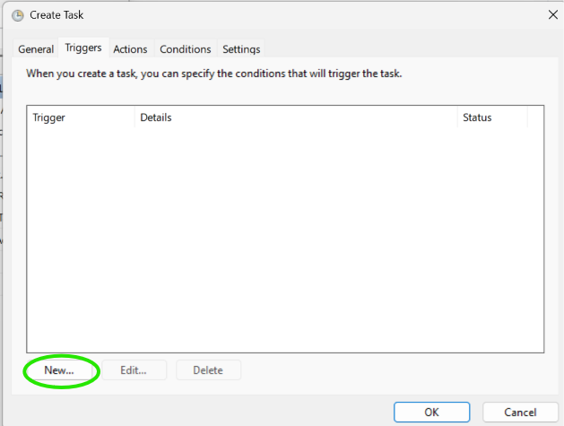
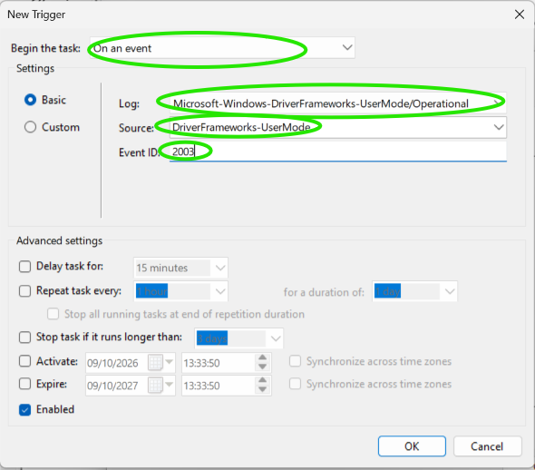
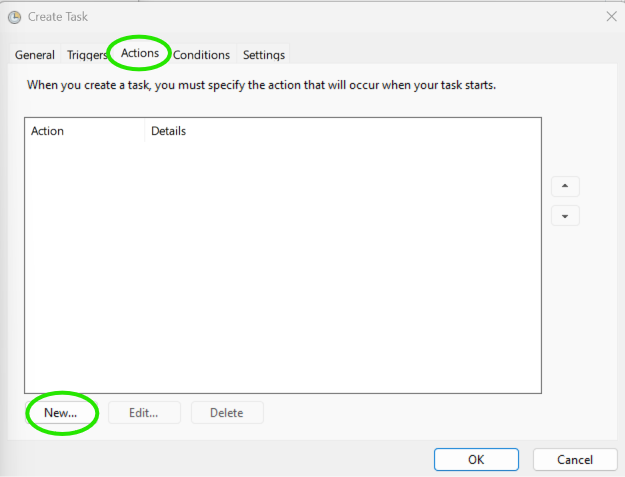
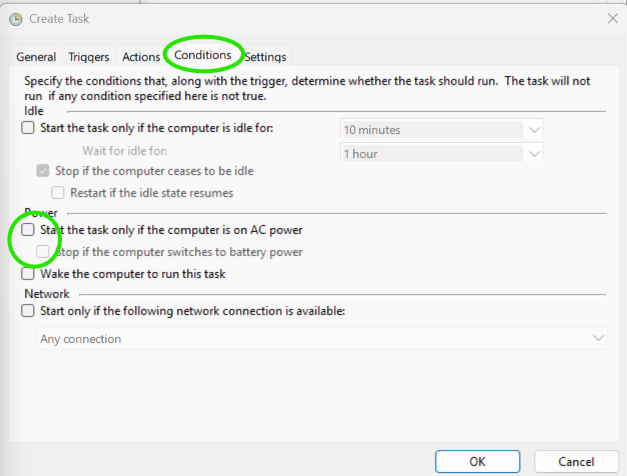

# Twenty20

How to implement the 20-20-20 rule on your laptop device using a USB or other plugable devices to trigger the Twenty20 code that beeps every 20 minutes, twice at the start of the 20 seconds and three times at the end.

The idea I implemented is that any time you have a USB memory stick in your laptop, it with trigger an event and run the code automatically. It will give an initial beep so you know the timer has started, and then will function as required.

Complete set up as follows:

---

### **1. Identify USB Hardware ID**

Input the following code into PowerShell:

*(To open PowerShell, press Windows and type PowerShell to find)*

```powershell
Get-PnpDevice -Class USB | Where-Object { $_.FriendlyName -like "*Mass Storage*" -or $_.FriendlyName -like "*Flash*" } | Select-Object FriendlyName, InstanceId
```

---

### **2. Save Code**

Create a folder `C:\twenty20`  
Save file into this folder.

---

### **3. Run USB Event Log**

Press **Windows** and **X** at the same time and run:

```cmd
wevtutil sl "Microsoft-Windows-DriverFrameworks-UserMode/Operational" /e:true
```

to enable device arrival events.

---

### **4. Task Schedule**

#### **i. Open Task Scheduler**
Press **Windows** and **R** at the same time, type `taskschd.msc`, and press **Enter**.  
This opens the schedule window.


#### **ii. Create Task**



#### **iii. General Tab**
- **Title:** `twenty20_auto`  
- Only run when user logged on  



#### **iv. Triggers Tab**



- Click **New**
- Begin task: **On an event**
- **Log:** `Microsoft-Windows-DriverFrameworks-UserMode/Operational`
- **Source:** `DriverFrameworks-UserMode`
- **Event ID:** `2003`



#### **v. Actions Tab**



- Type in: `powershell.exe`
- Arguments:
```text
-WindowStyle Hidden -ExecutionPolicy Bypass -File "C:\twenty20\twenty20.ps1"
```

#### **vi. Conditions Tab**



- Uncheck boxes
- Set to do not start new instances

---

### **5. Verification**

Type into PowerShell:

```powershell
Get-CimInstance Win32_Process -Filter "Name = 'powershell.exe'" | Select-Object ProcessId, CommandLine
```

to check it has worked.
